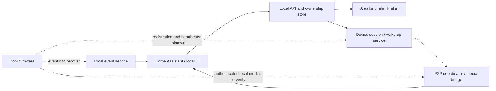

# XHome local-only feasibility

Research date: 2026-09-07. Based on XHome 1.6.4.8 and repository baseline
`f88c922`. See the [pairing protocol](PAIRING_PROTOCOL.md) for messages and
source evidence.

## Bottom line

**An independent provisioning tool looks feasible. A completely local
replacement service is plausible but not yet demonstrated.**

The important missing evidence is the **door firmware's side** of registration,
authentication, wake-up, and server selection. Reverse-engineering the phone's
REST requests alone does not establish that the door will accept our server.

The recommended direction is a **custom HA/local client plus the smallest
necessary local device service**, rather than cloning the entire vendor cloud
to preserve the unmodified Android app.

No device was reset, rebound, unlocked, reflashed, or redirected during this
research. No replacement server was deployed.

## What “local-only” should mean

A finished local-only version should be able to start and reconnect, receive
events, and provide the agreed camera/door functions without the door, HA
adapter, or local service contacting the vendor.

Two different claims must be tested separately:

- **Offline after existing pairing:** uses an already provisioned door and
  previously established authorization.
- **Offline from fresh setup:** provisions and establishes ownership without a
  vendor account, vendor-issued pairing key, or vendor token refresh.

A stream that keeps running after internet access is lost proves neither fresh
setup nor cold-start/reconnection independence.

## Feasibility by approach

| Approach | Assessment | Main dependency / missing proof |
|---|---|---|
| Existing HA integration | Working cloud-assisted client, not local-only | REST metadata/token, native IoT login, connection coordination |
| Own AP/BLE Wi-Fi provisioner | Good source-level basis | Verify the installed hardware's mode and response behavior |
| Direct LAN media after vendor pairing | Worth testing; not demonstrated offline here | Door wake-up, authorization lifetime, peer discovery without backend |
| Local server with a custom HA/client frontend | Plausible, conditional | Door-side registration, authentication, endpoint redirection, event delivery |
| Local server with the unmodified XHome app | Substantially harder; not a DNS-only change | Android pins, explicit DNS, fixed route map, broad API compatibility |
| Firmware modification/replacement | Contingency, not an established path | Hardware identification, firmware access, boot/update trust, recovery capability |

BLE provisioning support does not establish BLE support for the door's video or
all lock operations. Other BLE-only products in the same app are not evidence
about this Wi-Fi door.

## Confirmed building blocks

### Local provisioning

The app uses local UDP/HTTP or BLE to deliver Wi-Fi details. Discovery and BLE
framing have now been traced far enough to design an independent provisioner:

- UDP JSON discovery/configuration on destination port 5000.
- Device AP HTTP compatibility request.
- BLE FFF0/FFF1/FFF4 service/characteristics.
- Legacy fixed-layout and newer TLV Wi-Fi messages.

However, the newer payloads supply a **region code**, not a server URL.
The legacy BLE payload and HTTP compatibility body do not even supply a region.
Neither route establishes that a device will work before cloud registration.

### Reusable camera and client code

The repository already contains useful components:

| Component | Existing implementation | What it does not prove |
|---|---|---|
| REST client and token models | [client.py](../src/xhome/client.py), [models.py](../src/xhome/models.py) | Device-side login/ownership protocol |
| Native IoT framing/login | [live_transport.py](../src/xhome/live_transport.py) | A server that real firmware accepts |
| P2P discovery/punching/media | [live_p2p.py](../src/xhome/live_p2p.py), [live_kcp.py](../src/xhome/live_kcp.py) | Cloud-free session establishment |
| JPEG media reconstruction | [live.py](../src/xhome/live.py) | Firmware authentication or wake-up |
| App-side push transport | [push.py](../src/xhome/push.py) | Door-to-server event registration/delivery |

The current [camera worker](../custom_components/xhome/camera.py) creates
`XHomeLiveCloudTransport`, logs in, sends the stream-start command, and waits
for server-provided P2P endpoints. Direct peer candidates in the implementation
do **not** make that startup sequence independent of the cloud.

The local push listener is an alternative **client of the vendor push service**,
not a replacement for that service or proof of direct door-to-HA events.

## Why DNS redirection alone is insufficient

### Android app constraints: confirmed

1. **Fixed regional endpoints.** `api/g.java` maps recognized regions/hosts to
   hard-coded REST, native IoT, and push addresses. Unknown strings fall back to
   the default region rather than becoming a custom server.
2. **TLS certificate pinning.** `api/n.java:124` builds pins for the regional
   REST hosts and additional Lancens services; `:175` installs that pinner.
   A normal private-CA certificate does not satisfy the expected public-key
   pins. Dynamic pin-refresh code still belongs to the vendor trust scheme.
3. **Explicit DNS resolver configuration.** `api/n.java:157` configures
   `114.114.114.114:53` for China/test and `8.8.8.8:53` otherwise, through
   the app's DNS wrapper. A router-local DNS override must not be assumed to
   control every app lookup.
4. **Cloud pairing transaction.** AP/BLE setup waits on backend online status
   and authenticated binding; QR setup needs a cloud-issued pairing key first.

These are findings about the **Android app**. They must not be projected onto
the door: firmware DNS behavior, TLS verification/pinning, client certificates,
and authorization checks are still unknown.

A custom frontend under our control can use our own service address and trust
configuration. That avoids reproducing the Android app's compatibility
requirements, but it does not remove any checks implemented in the door.

## What an own server would need

A minimal design has separate frontend and device-facing roles:

Dashed links are required capabilities, not implemented or verified protocols.

| Service role | Required work | Evidence level |
|---|---|---|
| Local ownership/account store | Associate the physical door with a local owner and permissions | Can design ourselves; matching device-side enrollment remains unknown |
| Provisioning frontend | Select discovered device, send supported Wi-Fi payload, observe completion | App-side messages recovered; hardware test pending |
| Device session service | Accept actual door registration, maintain heartbeat/state, support sleep/wake | Firmware-facing exchange not recovered |
| Authorization | Issue or retain credentials the door actually accepts; support reconnect/revocation | Token validation location, signing scheme, and lifetime unresolved |
| Session coordination/media | Return appropriate peer information and reuse media decoder/bridge | Client-side framing and camera decoder available |
| Events | Receive doorbell, battery/state, and access events and forward locally | App push protocol known; device event ingress unknown |
| Persistence/time | Retain identity, permissions, and required timing state across restarts | Needs firmware observations |

### Known ports are client-side observations

| Port/transport | Observed role | Scope |
|---|---|---|
| UDP 5000 | Local discovery and Wi-Fi provisioning | Recovered from app LANUDP library |
| HTTP 80 | Device AP compatibility endpoint | App attempts `192.168.1.1/No_content` |
| HTTPS 6448 | Regional REST API | App-to-cloud |
| TLS 11201 | Native IoT login/control | Existing client uses command 10001 with UID/token |
| TLS 11001 | Lancens app push | Existing app-side/client-side implementation |
| UDP ports from session response | Rendezvous/direct/relay paths | Negotiated/server-advertised, not a universal fixed media port |

Do not assume the door registers on the same ports or with the same messages
as the app. A mock of these client endpoints could make a UI advance without
producing any working door session.

## Critical unanswered questions

1. Which provisioning mode and protocol variant does the installed door use?
2. What destinations does the **door itself** contact after Wi-Fi setup, boot,
   sleep/wake, and a doorbell press?
3. Can its server destination be configured, or would controlled network
   redirection be necessary? Does it use DNS, fixed IPs, or a discovery service?
4. What does the door verify about the server certificate and peer identity?
5. Where are native live/control tokens checked: cloud, device, or both?
   Are they renewable locally? If firmware requires vendor-signed tokens that
   we cannot issue, a server clone alone is not enough.
6. Can an already authorized door accept a new direct LAN session while the
   vendor is unavailable, including after sleep and a cold restart?
7. Which state and enrollment records survive firmware reboot or network loss?
8. Are media, remote unlock, status, and event delivery all using the same
   backend connection, or separate paths?

The saved app-side streaming capture is useful for media/session analysis, but
does not substitute for a capture of the door's own uplink during enrollment.

## Recommended proof-of-concept sequence

This is a proposed next phase, not work already performed.

### Phase 1 — Observe the existing door without re-pairing

- Record model, firmware, setup-mode support, and its LAN network identity
  using existing inventory or non-mutating observation.
- Capture the door's own traffic at an authorized router/AP mirror during a
  normal camera session and natural sleep/wake events.
- Produce a sanitized destination/transport/timing map. Keep capture contents,
  tokens, and Wi-Fi/pairing data in protected local storage, not in Git.
- Identify whether direct-LAN media is used and which cloud exchanges precede it.

Deliverable: device-side connection map plus a concrete, reversible offline
test plan. Existing phone captures can be compared locally without changing
the door.

### Phase 2 — Test offline-after-pairing

During an agreed controlled test, temporarily isolate the door **and the test
client/adapter** from vendor/internet access while retaining the intended LAN
path. Preserve the original network state for restoration.

Test separate cases:

| Case | What it establishes |
|---|---|
| Existing stream survives | Continuation only |
| Stop and open a new stream | Offline session establishment |
| Door sleeps and wakes, then a new stream opens | Offline wake/reconnect |
| Client/service restarts and reconnects | No hidden in-memory cloud dependency |
| Controlled door restart, then reconnect | Boot-time independence |
| Authorization ages past the observed refresh period | Not just a cached short-lived token |

Start with camera/status/event functions. Test physical lock actuation only as
a separately deliberate operation, not as a generic connectivity probe.

Deliverable: per-function pass/fail evidence. Success here would support an
offline-after-pairing mode, not automatically offline fresh enrollment.

### Phase 3 — Minimum local backend

Only after the device-facing handshake and trust requirements are understood:

- Build the smallest local service the firmware can actually use.
- Prefer a new HA/local API over cloning unrelated vendor accounts, payments,
  sharing, mobile push providers, and cloud storage.
- Implement real local ownership and authorization; do not count unconditional
  success responses as pairing.
- Reuse the existing camera parser and media transport where appropriate.
- If the firmware cannot trust or authorize a local backend, record that as the
  limiting result before considering firmware work.

Deliverable: one real door session through the local service with the vendor
unreachable, plus restart/reconnect evidence.

### Phase 4 — Fresh local pairing

Use a spare/test unit, or a separately agreed recoverable pairing procedure,
to prove provisioning and ownership from the beginning without a vendor
account. Cover the device's actual setup route rather than requiring all app
modes.

Deliverable: a repeatable offline enrollment procedure and a tested local-only
feature matrix.

## Verification and limits of this report

Completed:

- Read the saved Java/smali provisioning, cloud binding, regional routing, and
  app TLS/DNS code.
- Decompiled the ARM64 LANUDP library and checked address-specific UDP framing,
  destination port, receive binding, and response behavior.
- Compared the proposed architecture with the current HA/client startup paths.
- Recorded source locations and artifact hashes in the pairing document.

Not completed: live pairing, firmware extraction, endpoint redirection,
offline-function tests, or an operational server replacement. Documentation
validation is not a substitute for those tests.

The current session's Home Assistant connector reports a DNS failure for
`homeassistant.local`; the operator-specified endpoint is
`ha.my.track-point.de`. This does not block static app analysis, but no live
HA verification is claimed.

**Decision:** pursue the door-side observation and a direct-LAN offline test
first. Build a server only once the handshake evidence shows what it must do.
